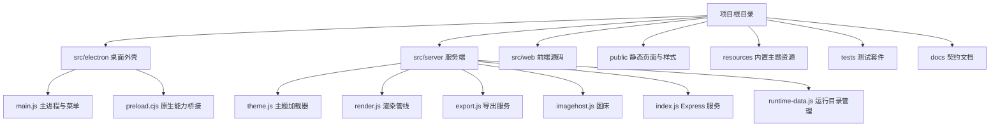

# TYPOAR

基于对 Typora 1.14.10 应用包逆向契约实现的 macOS 桌面应用。应用采用 Electron 框架，实现 Typora DOM 容器契约与基础样式兼容。支持导入外部 Typora 主题文件直接使用。

- **GitHub 仓库**：[https://github.com/Jiao77/typora-compatible-editor](https://github.com/Jiao77/typora-compatible-editor)
- **Gitea 仓库**：[https://gitea.jiao77.com/Jiao77/typora-compatible-editor](https://gitea.jiao77.com/Jiao77/typora-compatible-editor)
- **历史发布版本**：
  - [GitHub Releases 资产下载 (v1.0.0 arm64.zip)](https://github.com/Jiao77/typora-compatible-editor/releases/download/v1.0.0/Typora-Compatible-Editor-1.0.0-mac-arm64.zip)
  - [Gitea Releases 页面](https://gitea.jiao77.com/Jiao77/typora-compatible-editor/releases/tag/v1.0.0)
- **当前开发状态**：当前开发分支为 `codex/local-takeover`，基于已发布的 `main` 分支代码接管。本地支持直接构建、运行、测试与打包。

## 功能范围

| 类别 | 能力说明 |
| :--- | :--- |
| 主题支持 | 内置 8 款主题（`github`、`night`、`latex`、`latex-dark`、`pixyll`、`gothic`、`newsprint`、`whitey`），支持加载用户主题目录中的 CSS、字体与图片资源 |
| 主题级联 | 按照 `{theme}.css` → `base.user.css` → `{theme}.user.css` 顺序加载覆盖样式 |
| 应用形态 | Electron 桌面应用，提供无边框一体化标题栏、原生菜单与原生文件选择对话框 |
| 编辑交互 | Typora 风格单栏就地渲染。正文按块排版，点击对应块即可就地编辑 Markdown 源码 |
| 界面布局 | 提供可折叠大纲与文件侧边栏、底部状态栏字数统计、快捷菜单与实时查找栏 |
| 偏好设置 | 独立设置窗口，涵盖外观、编辑器、Markdown 语法、图像、导出与关于选项 |
| 数学公式 | 集成 MathJax 4.1.3，以 SVG 格式渲染行内公式与独立块级公式 |
| 图表渲染 | 支持 Mermaid、flowchart.js 与 js-sequence-diagrams 代码围栏实时渲染 |
| 语法扩展 | 支持表格、定义列表、脚注、任务列表、Callout、`[TOC]`、上下标、高亮与 Emoji |
| 实时排版 | 服务端按顶层块输出标准 DOM 结构，前端负责补齐交互与矢量图表 |
| 文档导出 | 支持导出为 HTML、PDF（Chrome 无头打印）、docx、odt、rtf、epub、latex 与 mediawiki（调用 Pandoc） |
| 图床集成 | 支持本地目录存储、PicGo 与 PicList 接口、PicSee、uPic 以及自定义 HTTP 接口 |

## 环境要求

| 软件或工具 | 规格要求 | 本机实测快照 | 用途说明 |
| :--- | :--- | :--- | :--- |
| 操作系统 | macOS | macOS 27.0.1 (Darwin 27.0.0, arm64) | 宿主系统运行环境 |
| Node.js | >=20 (`package.json` engines) | v26.11.1 (`/opt/homebrew/bin/node`) | 后端服务与构建运行环境 |
| npm | 随 Node.js 安装 | 11.20.0 (`/opt/homebrew/bin/npm`) | 依赖安装与脚本执行 |
| Google Chrome | 已安装本机 | 155.0.8059.80 (`/Applications/Google Chrome.app`) | PDF 导出与无头渲染 |
| Pandoc | 已安装本机 | 3.12.1 (`/opt/homebrew/bin/pandoc`) | docx、epub、latex 等文档格式转换 |

## 安装与启动

在项目根目录下执行以下命令：

```bash
# 安装依赖
npm ci

# 构建第三方图表脚本与前端页面
npm run build

# 启动源码版桌面客户端
npm run desktop

# 启用调试参数启动源码版桌面客户端
npm run desktop:dev
```

本机已安装的应用可通过以下命令启动：

```bash
env -u ELECTRON_RUN_AS_NODE open '/Applications/TYPOAR.app'
```

在外部浏览器中调试 Web 界面，推荐使用本机磁盘专属数据目录：

```bash
TYPORA_DATA_DIR="$HOME/Library/Application Support/typora-compatible-editor/dev" npm start
# 浏览器访问 http://127.0.0.1:7788
```

## 自动化测试

运行测试套件时，建议指定本机磁盘独立数据目录执行：

```bash
TYPORA_DATA_DIR="$HOME/Library/Application Support/typora-compatible-editor/test" npm test
```

全套 97 项自动化测试全部通过（97 pass，0 fail，0 skipped，退出码 0，全量回归日志保存在 `work/typoar_brand_20261016/full_tests.log`）。

在本次项目所在 QNAS 卷与本机磁盘的对照实验中：Chrome 的 `user-data-dir` 位于 QNAS 卷时，进程退出码为 2 且耗时约 24–34 秒（触发看门狗超时）；位于本机磁盘用户目录时，进程退出码为 0 且耗时约 1.3–2.3 秒。

## 客户端打包与分发

项目提供 macOS 客户端打包命令，打包前自动调用 `npm run build`：

```bash
# 构建桌面应用包与便携 ZIP 压缩包
npm run package:mac

# 链式调用 package:mac 组装应用并制作 UDZO 格式磁盘镜像 DMG
npm run package:dmg

# 一次性生成完整分发产物
npm run package
```

若直接复用已安装的应用包生成 DMG 镜像，跳过重新构建环节，执行以下命令：

```bash
TYPORA_APP_PATH="/Applications/TYPOAR.app" node scripts/make-dmg.js
```

`make-dmg.js` 脚本将自动核验目标应用的存在性、代码签名有效性（`codesign --verify --deep --strict`）、版本号与二进制架构（`lipo -archs`），核验通过后执行镜像制作。

### 产物与安装位置说明

- **本机安装应用**：`/Applications/TYPOAR.app`（已完成系统安装与本地代码签名验证，`codesign --verify --deep --strict` 退出码为 0，`Info.plist` 显示名称为 TYPOAR 且品牌图标哈希校验一致）。
- **分发目录产物** (`dist-package/`)：
  - `TYPOAR-1.0.0-mac-arm64.zip`：便携 ZIP 压缩包，解压即可运行。
  - `TYPOAR-1.0.0-mac-arm64.dmg`：UDZO 压缩格式磁盘镜像，内置 `/Applications` 软链接替身。
  - `manifest.json` 与 `SHA256SUMS.txt`：记录各分发产物的实时文件大小与 SHA256 校验码。
- **构建操作建议**：在本次项目所在 QNAS 卷执行大量文件读写耗时较长；建议通过环境变量 `TYPORA_PACKAGE_DIR` 指定本机磁盘目录执行打包，生成的归档文件可写回 `dist-package/`。

### 验证范围与边界说明

- 已验证范围：安装版与源码版 Electron 启动与界面渲染、主题与资源加载、MathJax 公式与三类图表矢量固化、HTML/PDF/DOCX/EPUB/LaTeX 导出管道，以及偏好设置重启持久化。
- 未测试边界：原生系统文件选择与保存弹窗（`dialog.showOpenDialog` 与 `dialog.showSaveDialog`）依赖图形界面交互，未执行人工点击测试；底层文件读写逻辑均通过真实 API 接口完成验证。

## 目录结构



## 使用说明

### 就地编辑

编辑器采用单栏就地排版呈现：

| 操作 | 行为 |
| :--- | :--- |
| 点击任意块 | 该块切换为 Markdown 源码编辑器，其余块保持排版呈现 |
| 点击其它块或按 Escape | 提交当前块修改并重新排版 |
| 段落内按 Enter | 拆分为两个独立段落 |
| 段落内按 Shift + Enter | 在段落内部插入换行标记 |
| 列表项内按 Enter | 生成新列表项，任务列表接续 `- [ ]` 标记 |
| 空列表标记处按 Enter | 清除列表标记并退出列表编辑 |
| 空段落按 Backspace | 将当前空段落合并至上一块末尾 |
| 块首或块尾按方向键 | 切换至相邻块级内容 |

### 快捷键

| 快捷键 | 功能 | 代码实现位置 |
| :--- | :--- | :--- |
| `Cmd + O` | 打开本地 Markdown 文件 | `src/electron/main.js` |
| `Cmd + S` | 保存当前文档 | `src/electron/main.js` |
| `Cmd + F` | 打开页面查找栏 | `src/electron/main.js` |
| `Cmd + ,` | 打开偏好设置窗口 | `src/electron/main.js` |
| `Cmd + /` | 切换源码模式与就地排版模式 | `src/electron/main.js` |
| `Alt + Cmd + I` | 切换开发者工具 | `src/electron/main.js` |
| `Cmd + Enter` / `Escape` | 提交当前块编辑并恢复排版呈现 | `src/web/editor-setup.js` |

### 文档导出

点击底部状态栏「导出」按钮展开导出菜单：
- **PDF 与 HTML**：由本地服务调用无头 Google Chrome 打印渲染，将数学公式与图表固化为 SVG 矢量图形。
- **Office 与标记文档**：调用本地 Pandoc 转换为 docx、odt、rtf、epub、latex 与 mediawiki 格式。

### 运行目录与存储规范

数据存储目录统一通过环境变量 `TYPORA_DATA_DIR` 控制：
- **桌面模式**：未设置时，默认使用本机磁盘路径 `~/Library/Application Support/typora-compatible-editor`。
- **Web 模式**：通过 `npm start` 启动时，可通过 `TYPORA_DATA_DIR` 指向本机磁盘独立目录（如 `~/Library/Application Support/typora-compatible-editor/dev`）。
- **存储项规划**：偏好设置 `settings.json`、上传图片 `uploads/`、导出文档 `exports/` 与导出缓存 `tmp/` 均保存在该数据目录下。

## 配置项

客户端偏好设置保存在数据目录下的 `settings.json` 文件中，对应默认配置如下：

| 配置键 | 说明 | 默认值 |
| :--- | :--- | :--- |
| `theme` | 默认明色主题 | `Github` |
| `darkTheme` | 默认暗色主题 | `Night` |
| `image_uploader` | 默认图床上传通道 | `ipic` |
| `enable_inline_math` | 是否启用行内数学公式 | `true` |
| `strict_mode` | 是否开启严格排版模式 | `true` |
| `allowPhysicsConflict` | 允许物理公式宏定义冲突 | `true` |
| `followSystem` | 跟随操作系统明暗外观 | `true` |
| `fontSize` | 编辑器基础字号（像素） | `16` |
| `autoSave` | 是否开启文档自动保存 | `false` |
| `autoSaveDelay` | 自动保存延时（秒） | `5` |
| `spellcheck` | 启用拼写检查 | `true` |
| `enable_diagrams` | 启用扩展图表围栏 | `true` |
| `enable_toc` | 启用目录生成语法 | `true` |
| `pageSize` | 导出页面规格 | `A4` |
| `margin` | 导出外边距（毫米） | `16` |
| `targetDir` | 本地图床存储目标路径 | `""` |
| `endpoint` | 自定义上传接口地址 | `""` |
| `url` | 自定义图床接口地址 | `""` |

## 兼容性说明

编辑器实现了 Typora 基础样式容器契约，包括 `#write` 根容器、核心块级排版类名、表格容器、任务列表复选框、公式容器与图表挂载节点。支持导入外部 Typora 主题文件直接使用。

详细契约见 [docs/typora-compat-spec.md](docs/typora-compat-spec.md)。
