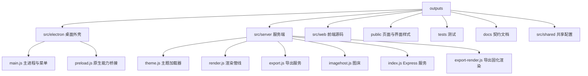

# Typora 兼容 Markdown 编辑器

基于 REA 对 Typora 1.14.10 应用包的逆向契约实现的 macOS 桌面应用，采用 Electron 架构，与 Typora 同源。Typora 主题文件可原地迁移使用，无需改写 CSS。

- **GitHub 仓库**: [https://github.com/Jiao77/typora-compatible-editor](https://github.com/Jiao77/typora-compatible-editor)
- **Gitea 仓库**: [https://gitea.jiao77.com/Jiao77/typora-compatible-editor](https://gitea.jiao77.com/Jiao77/typora-compatible-editor)
- **v1.0.0 发布版下载**:
  - [GitHub Releases 资产下载 (arm64.zip)](https://github.com/Jiao77/typora-compatible-editor/releases/download/v1.0.0/Typora-Compatible-Editor-1.0.0-mac-arm64.zip)
  - [Gitea Releases 页面](https://gitea.jiao77.com/Jiao77/typora-compatible-editor/releases/tag/v1.0.0)


## 功能范围

| 类别 | 能力 |
| --- | --- |
| 主题迁移 | 直接加载 Typora 用户主题目录与内置主题目录的 CSS，含字体与图片资源 |
| 主题级联 | `{theme}.css` → `base.user.css` → `{theme}.user.css` |
| 应用形态 | Electron 桌面应用，无边框一体化标题栏、原生菜单、原生文件对话框 |
| 编辑 | Typora 式单栏就地渲染：正文按块渲染，点击任意块切换为源码编辑器 |
| 界面 | 可收起侧边栏（大纲与文件）、状态栏字数统计、浮动主题与导出菜单、查找栏 |
| 偏好设置 | 独立窗口，六个分类：外观、编辑器、Markdown、图像、导出、关于 |
| 数学公式 | MathJax 4.1.3，SVG 输出，支持行内与块级公式 |
| 图表 | Mermaid 12.2.0 负责 `mermaid` 围栏，flowchart.js 1.18.0 负责 `flow` 围栏，js-sequence-diagrams 负责 `sequence` 围栏 |
| Markdown | 标准语法加表格、定义列表、脚注、任务列表、Callout、`[TOC]`、上下标、高亮、Emoji |
| 实时预览 | 服务端按顶层块渲染 Typora 契约 DOM，浏览器端补齐公式与图表，无分栏 |
| 导出 | HTML、PDF（Chrome 无头，公式与图表固化为 SVG）、docx、odt、rtf、epub、latex、mediawiki（pandoc） |
| 图床 | 本地目录、PicGo 与 PicList 接口、PicSee、uPic、自建 HTTP 接口 |

## 环境要求

| 依赖 | 版本 | 说明 |
| --- | --- | --- |
| Node.js | 20 及以上 | 当前实测 26.11.1 |
| Google Chrome | 任意现代版本 | PDF 导出所需 |
| pandoc | 2.0 及以上 | docx、odt、rtf、epub、latex、mediawiki 导出所需，当前实测 3.12.1 |

## 安装与启动

作为桌面应用启动：

```bash
cd outputs
npm install
npm run build
npm run desktop
```

桌面应用自带内部服务，端口由系统分配，无需手动配置。

需要在浏览器中调试界面时：

```bash
npm start
# 访问 http://127.0.0.1:7788
```

## 目录结构



## 使用方式

### 就地编辑

编辑器采用 Typora 的单栏就地渲染方式，没有左右分栏：

| 操作 | 行为 |
| --- | --- |
| 点击任意块 | 该块切换为 Markdown 源码编辑器，其余块保持最终排版 |
| 点击其它块或按 Escape | 提交当前修改并重新渲染 |
| 段落内按 Enter | 拆分为两个独立段落 |
| 段落内按 Shift + Enter | 段内软换行 |
| 列表内按 Enter | 接续列表标记，任务列表接续 `- [ ]` |
| 列表标记处按 Enter | 清除标记并结束列表 |
| 空段落按 Backspace | 合并到上一块 |
| 光标在块首/块尾按方向键 | 切换到相邻块 |
| 顶部「源码模式」 | 切换为整篇 Markdown 源码编辑 |

### 图表语法

三类图表围栏按 Typora 的真实实现分发到不同渲染引擎，导出时全部固化为 SVG：

| 围栏语言 | 渲染引擎 | 说明 |
| --- | --- | --- |
| `mermaid` | Mermaid 12.2.0 | 流程图、时序图、甘特图、类图等 |
| `flow` | flowchart.js 1.18.0 | Typora 传统的 `st=>start` 语法 |
| `sequence` | js-sequence-diagrams 2.0.1 | Typora 传统的 `Alice->Bob` 语法 |

### 主题切换

界面顶部的主题下拉框列出全部可用主题，用户主题标记为「用户主题」，内置主题标记为「内置主题」。选择后立即加载对应 CSS。

新增主题只需把 `.css` 文件与配套字体、图片目录复制到 Typora 用户主题目录，刷新页面即可。

### 图片上传

点击「插入图片」选择本地文件，或直接把文件拖入页面。上传成功后自动在光标位置插入 Markdown 图片语法。

图床选择与参数在设置接口中配置：

```bash
curl -X POST http://127.0.0.1:7788/api/settings \
  -H 'Content-Type: application/json' \
  -d '{"image_uploader":"local","targetDir":"images"}'
```

### 导出

界面顶部按钮分别触发 PDF、HTML 与 pandoc 导出，导出路径在弹出输入框中填写绝对路径。

## 接口一览

| 方法 | 路径 | 用途 |
| --- | --- | --- |
| GET | `/api/themes` | 列出全部主题 |
| GET | `/api/themes/:id/css` | 获取编译后的主题 CSS |
| GET | `/theme-assets/:id/*` | 获取主题字体与图片资源 |
| POST | `/api/render` | 渲染 Markdown 为 Typora 契约 HTML |
| POST | `/api/preview` | 渲染完整预览文档 |
| POST | `/api/export/html` | 导出 HTML |
| POST | `/api/export/pdf` | 导出 PDF |
| POST | `/api/export/pandoc` | 通过 pandoc 导出其他格式 |
| POST | `/api/file/open` | 打开 Markdown 文件 |
| POST | `/api/file/save` | 保存 Markdown 文件 |
| GET | `/api/images/uploaders` | 列出图床上传器 |
| POST | `/api/images/upload` | 上传图片 |
| GET/POST | `/api/settings` | 读取与写入设置 |
| GET | `/api/environment` | 探测 Chrome 与 pandoc |

## 测试

```bash
cd outputs
npm test
```

测试覆盖主题加载、块级解析、渲染契约、图表固化、导出链路、图床上传、文件读写、桌面外壳与全部接口，共 66 项，全部使用真实文件、真实浏览器与真实子进程执行。

## 配置项

设置文件位于 `work/settings.json`，可配置项包括：

| 键 | 说明 | 默认值 |
| --- | --- | --- |
| `theme` | 默认主题 | `Github` |
| `darkTheme` | 暗色主题 | `Latex` |
| `image_uploader` | 图床上传器 | `ipic` |
| `enable_inline_math` | 行内公式 | `true` |
| `targetDir` | 本地图床目标目录 | 未设置 |
| `endpoint` | PicGo 兼容接口地址 | `http://127.0.0.1:36677/upload` |
| `url` | 自定义上传接口地址 | 未设置 |

## 兼容性说明

主题 CSS 的输出结构与 Typora 保持一致，包括 `#write` 容器、全部 `md-*` 类名、表格 `td-span`、任务列表状态类名、公式 `mjx-container` 与图表 `md-diagram` 容器。Typora 原版主题文件可直接迁移使用。

详细契约见 [docs/typora-compat-spec.md](docs/typora-compat-spec.md)。
