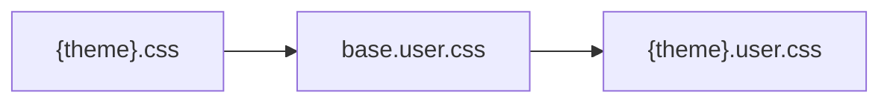
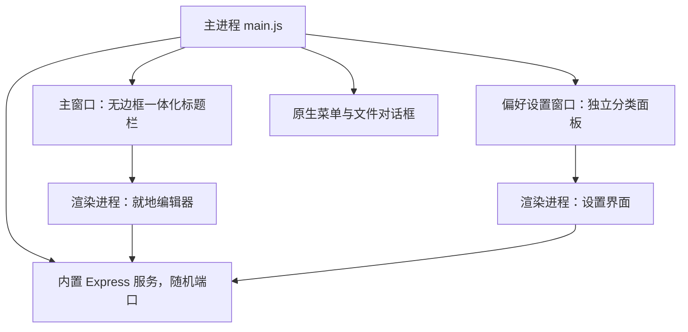
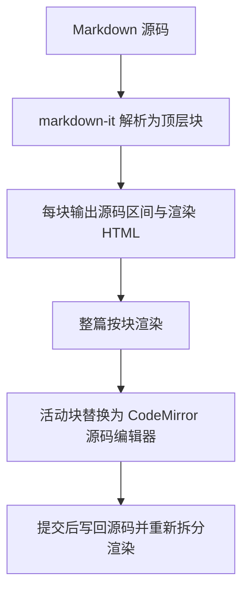
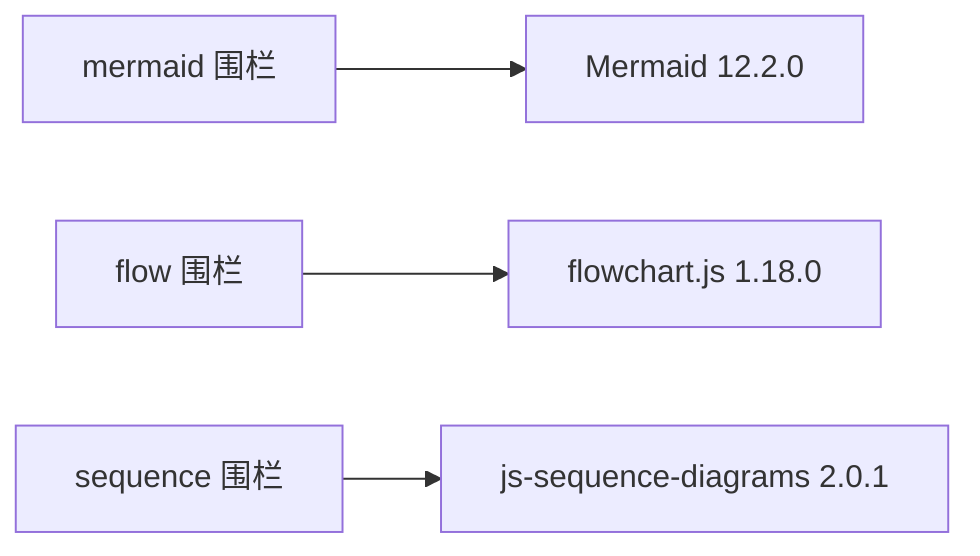

# Typora 兼容契约规格说明

本文档记录从 Typora 1.14.10（构建 7786）应用包逆向得到的真实契约，工程实现严格遵循这些契约。

## 一、应用包身份

| 项目 | 取值 |
| --- | --- |
| 版本 | 1.14.10 |
| 构建号 | 7786 |
| Bundle ID | abnerworks.Typora |
| 架构 | universal（x86_64 + arm64） |
| 应用包 SHA-256 | c69cc46a4b31be4549f57e8053b756f44e8d60e853234c5a1826e855827f640b |
| 主可执行文件 SHA-256 | 71aebecaac7b21965c541113b6e0d9b792a095f44aa487a0a6366f224fcbb83a |

注册的文档扩展名：`md markdown mmd mdown mkd mdwn mdtxt mdtext rmarkdown rmd apib qmd mdx txt text`。

## 二、主题契约

主题目录分两层，用户目录优先：

- 用户主题目录：`~/Library/Application Support/abnerworks.Typora/themes`
- 内置主题目录：`/Applications/Typora.app/Contents/Resources/TypeMark/style/themes`

级联加载顺序固定为三层：



主题标识归一化规则来自 Typora 自身实现：

```js
value.replace(/\s*([A-Z])/g, '-$1').replace(/^-/, '').toLowerCase()
```

关键事实：

1. 内置主题为 github、gothic、newsprint、night、pixyll、whitey；用户目录额外提供 latex 与 latex-dark。
2. `@include-when-export url(...)` 是 Typora 自定义 at-rule，出现在 github.css、gothic.css、newsprint.css、pixyll.css，解析时必须原样保留。
3. `night.css` 前三行通过 `@import` 引入 `night/mermaid.dark.css`、`night/codeblock.dark.css`、`night/sourcemode.dark.css`，需要内联为实际内容。
4. 相对字体路径形如 `url('./github/open-sans-v17-latin-ext_latin-regular.woff2')`，需改写为 `/theme-assets/{themeId}/{相对路径}`。
5. 主题必须使用 MathJax 渲染公式，主题 CSS 中出现 8 处 `mjx-container` 选择器，KaTeX 无法匹配。

## 三、DOM 契约

正文容器固定为：

```html
<div id="write" class="write" role="textbox" aria-placeholder="Start writing..." aria-multiline="true" contenteditable="false" spellcheck="true" tabindex="-1">
```

块级元素结构：

| 语法 | 输出结构 |
| --- | --- |
| 段落 | `<p class="md-end-block md-p">` |
| 标题 | `<h{n} class="md-end-block md-heading">` |
| 引用 | `<blockquote>` |
| Callout | `<div class="md-alert md-alert-{type}">` |
| 任务列表项 | `<li class="md-list-item task-list-item md-task-list-item">` |
| 分隔线 | `<div tabindex="-1" contenteditable="false" class="md-hr md-end-block"><hr></div>` |
| 表格 | `<figure class="md-table-fig table-figure">`，单元格内 `<span class="td-span" contenteditable="true">` |
| 围栏代码 | `<pre class="md-fences mock-cm md-end-block">` |
| 图表 | `<div class="md-diagram md-fences-advanced md-fences md-end-block">` |
| 块级公式 | `<div class="md-math-block md-rawblock md-end-block">` |
| 行内公式 | `<span class="md-inline-math md-inline-math-container">` |
| 图片 | `<span class="md-image md-img-loaded"></span>` |
| 目录 | `<div class="md-toc md-end-block">` |
| Front Matter | `<pre class="md-meta-block md-end-block">` |

## 四、桌面应用架构

应用采用 Electron，与 Typora 的应用形态一致：



关键设计：

1. 内置服务监听随机端口，避免与用户已有服务冲突，桌面外壳无需固定端口。
2. 渲染进程启用 `contextIsolation` 并关闭 `nodeIntegration`，原生能力只经 `contextBridge` 暴露。
3. 文件打开与保存使用系统原生对话框，导出完成后可在访达中定位文件。
4. 内容安全策略必须允许 `blob:` worker，否则 Mermaid 渲染会永久挂起。
5. MathJax 4 用 `loader.paths.fonts` 解析字体扩展包，默认指向外部 CDN；离线运行必须改为本地目录。
6. 预加载脚本必须使用 CommonJS（本项目采用 `.cjs` 后缀）。`package.json` 为 `type: module` 时，以 `.js` 写成的 ESM 预加载会静默加载失败，`window.desktop` 随之缺失，界面会错误回退到浏览器跳转。
7. 窗口关闭确认由主进程接管。渲染进程若用 `beforeunload` 调用 `event.preventDefault()` 并设置 `returnValue`，Electron 窗口将无法关闭，且该拦截在渲染进程崩溃时也无法解除。
8. `setWindowOpenHandler` 必须区分站内与站外地址。一律调用 `shell.openExternal` 会把应用自己的偏好设置页错误地送到系统浏览器。

## 五、就地渲染架构

Typora 的编辑方式为单栏就地渲染，源码与预览共用同一位置，没有左右分栏。实现按以下方式对齐：



关键契约：

1. 文档源码是唯一数据源，块的源码区间以行号形式记录。
2. 每个顶层块独立渲染，块的 `open` 与 `close` 必须落在同一分组。
3. 相邻块的行区间可能重叠，写回时必须使用两块合并后的区间一次性替换。
4. 活动块内回车插入空行，提交后自然拆分为两个独立段落。
5. 列表与代码围栏内回车在块内续行，并接续列表标记。
6. 中文输入法组合期间不提交，避免打断输入。

## 六、Markdown 语法支持

块级语法：段落与单换行、标题、引用、有序与无序列表、任务列表、围栏代码、数学块、表格、定义列表、脚注、分隔线、YAML Front Matter、`[TOC]`、图表、Callout。

行内语法：链接、自动链接、图片、强调、加粗、行内代码、删除线、下划线、Emoji、行内公式、下标、上标、高亮。

其他：原生 HTML、iframe 嵌入内容、video 视频标签。

## 七、数学公式

采用 MathJax 4.1.3，SVG 输出，`fontCache` 使用 `local`。

实测输出规模：

| 配置 | 行内 | 块级 | 矩阵 |
| --- | --- | --- | --- |
| `local` | 4556 字节 | 6289 字节 | 4638 字节 |
| `global` | 1445 字节 | 1934 字节 | 1508 字节 |
| `none` | 4139 字节 | 6325 字节 | 4194 字节 |

`xypic` 包在 npm `mathjax` 4.1.3 中不存在，配置中必须剔除。可用 TeX 扩展共 41 个。

Node 端只有 bboldx、bbm、mhchem 三个扩展具备配套字体包，其余扩展在 Node 环境加载失败。因此公式渲染统一在浏览器端执行，服务端只输出占位标记，保证预览与导出结果一致。

## 八、导出流程

Typora 真实流程：生成临时 HTML 写入瞬时目录，调用 `export.genPrintView`，随后调用 `export.print` 或 `export.printToPDF`。

打印参数：`printBackground: true`，页面尺寸按毫米除以 25.4 换算为英寸，页边距默认 16，页眉页脚由 PDFLib 另行绘制。

本工程导出实现：

| 格式 | 实现方式 |
| --- | --- |
| HTML | 直接写入完整文档 |
| PDF | Chrome 无头 `--print-to-pdf --no-pdf-header-footer` |
| docx、odt、rtf、epub、latex、mediawiki | pandoc 3.12.1 |

导出 HTML 与 PDF 之前，公式与图表会先固化为 SVG，图表围栏源码随即移除，主题字体与图片内嵌为 data URI，导出文件可以脱离编辑器独立打开。

### 图表引擎分工

Typora 的三类图表围栏使用不同渲染引擎，实现必须按语言分发：



实测结论：Mermaid 无法解析 Typora 的 `flow` 与 `sequence` 围栏语法，必须分别交给 flowchart.js 与 js-sequence-diagrams。js-sequence-diagrams 依赖 jQuery、underscore 与 Raphael 三个全局前置库。

## 九、图床上传

内置上传器集合：`ipic`、`picgo-app`、`piclist-app`、`upic`、`picsee`、`picgo-cli`，默认 `ipic`。

PicGo 与 PicList 通过本地接口 `POST http://127.0.0.1:36677/upload` 上传：

```json
{ "list": ["<绝对文件路径>"] }
```

HTTP 状态码 200 且响应 `success === true` 时，取 `result` 数组中的 URL。

自定义上传器替换 `${filepath}` 与 `${filename}` 两个占位符。

## 十、配置项

本机 Typora 配置的真实取值：

```yaml
theme: Github
darkTheme: Latex
image_uploader: upic
enable_inline_math: true
strict_mode: true
allowPhysicsConflict: true
```

## 十一、实现边界

本工程通过公开规范与逆向得到的接口契约重新实现功能，不复制 Typora 专有实现，不绕过授权与保护机制。MathJax、Mermaid、CodeMirror、markdown-it、pandoc 均使用各自的开源发行版本。
