# TYPOAR Markdown 全语法演示

本文档用于展示与检查 TYPOAR 的 Markdown 及扩展语法；不同主题与外部方言显示可能有差异。文档涵盖基础排版、代码高亮、多级列表、GFM 规范、MultiMarkdown 扩展表格、MathJax 4 数学公式、Mermaid 图表以及 HTML 原生扩展标签。

[TOC]

---

## 一、标题层级演示

本节展示 Atx 与 Setext 两种标准的标题标记。

# 一级标题 H1（Atx 形式）
## 二级标题 H2（Atx 形式）
### 三级标题 H3（Atx 形式）
#### 四级标题 H4（Atx 形式）
##### 五级标题 H5（Atx 形式）
###### 六级标题 H6（Atx 形式）

Setext 一级标题
===============

Setext 二级标题
---------------

---

## 二、段落、换行与基础排版

本节演示自然段落、多空行分隔、软换行与强制换行。

这是第一段常规段落文本。Markdown 通过一个以上的空行将文本分割为独立段落。段落内部的长文本会根据编辑器视口宽度自然折行，排版容器保持自然两端对齐。

这是第二段常规段落文本。在中文技术文档排版中，中文词汇与英文单词（如 TYPOAR、Node.js）、半角数字（如 2026 年）之间保留一个半角空格。


上方保留了两个连续空行。TYPOAR 渲染器会将其保留为空行占位块，确保源码与预览在物理行映射上严格对齐。

这是一个包含软换行的段落：第一行文本
第二行文本紧随其后。在标准 CommonMark 模式下，单次回车被渲染为空格或软换行标签。

这是一个包含硬换行的段落：第一行文本末尾带有两个空格或者反斜线。  
这是经过强制硬换行后的第二行文本。

---

## 三、转义字符与 HTML 实体

本节展示保留字符的转义输出与常用 HTML 字符实体。

### 1. 反斜线转义字符
- 转义星号：\*这不是斜体\*
- 转义下划线：\_这不是下划线\_
- 转义波浪线：\~\~这不是删除线\~\~
- 转义等号：\=\=这不是高亮\=\=
- 转义反引号：\`这不是行内代码\`
- 转义方括号：\[这不是超链接\]
- 转义花括号：\{这不是属性标记\}
- 转义井号：\# 这不是标题行
- 转义竖线：\| 这不是表格分隔符 \|

### 2. HTML 字符实体
- 版权符号：&copy;（`&copy;`）
- 注册商标：&reg;（`&reg;`）
- 商标符号：&trade;（`&trade;`）
- 小于符号：&lt;（`&lt;`）
- 大于符号：&gt;（`&gt;`）
- 和号字符：&amp;（`&amp;`）
- 五角星号：&#9733;（`&#9733;`）
- 换行不间断空格：&nbsp;&nbsp;&nbsp;&nbsp;（四个连续 `&nbsp;` 空格）

---

## 四、行内文本格式与扩展样式

本节展示常用行内强调、删除、标注与上下标语法。

- **粗体强调**：使用两个星号包围 `**粗体文字**`，或者两个下划线 `__粗体文字__`。
- *斜体强调*：使用单个星号包围 `*斜体文字*`，或者单个下划线 `_斜体文字_`。
- ***粗斜体组合***：使用三个星号包围 `***粗斜体文字***`。
- ~~删除线文本~~：使用两个波浪号包围 `~~已废弃内容~~`。
- ==高亮文本标记==：使用两个等号包围 `==重点强调内容==`。
- ++下划线插入文本++：使用两个加号包围 `++新增文字内容++`。
- 上标与下标语法：水分子化学式为 H~2~O，勾股定理公式为 X^2^ + Y^2^ = Z^2^。
- 表情符号 Emoji：:smile:（`:smile:`）、:rocket:（`:rocket:`）、:white_check_mark:（`:white_check_mark:`）、:sparkles:（`:sparkles:`）、:tada:（`:tada:`）。
- 示例键帽排版：按下 <kbd>Ctrl</kbd> + <kbd>C</kbd> 复制选中文本。
- 拼音注音标签：<ruby>拼<rt>pīn</rt>音<rt>yīn</rt></ruby>。
- 行内代码：在语句中嵌入 `const version = "1.0.0";` 变量定义。
- 脚注引用标记：第一处常规脚注[^1]、第二处多段落脚注[^2]、长内容脚注[^long]，以及行内即时脚注^[这是直接写在正文里的行内脚注示例]。

---

## 五、全类型列表排版

本节涵盖无序列表、自定义起始序号列表、混合嵌套列表、多段落项与任务清单。

### 1. 多标记无序列表
* 使用星号作为项目标记的项目一
* 使用星号作为项目标记的项目二
- 使用减号作为项目标记的项目三
- 使用减号作为项目标记的项目四
+ 使用加号作为项目标记的项目五
+ 使用加号作为项目标记的项目六

### 2. 有序列表与起始序号
3. 有序列表第三项（以 `3.` 开头起排）
4. 有序列表第四项
5. 有序列表第五项
   1. 二级有序子项一
   2. 二级有序子项二

### 3. 多级混合嵌套列表
1. 第一层级有序项目 A
   - 第二层级无序子项 A-1
   - 第二层级无序子项 A-2
     * 第三层级无序子项 A-2-alpha
     * 第三层级无序子项 A-2-beta
2. 第一层级有序项目 B
   1. 第二层级有序子项 B-1
   2. 第二层级有序子项 B-2

### 4. 包含多段落的复合列表项
1. 第一个长项目标题
   
   这是长列表项内部包含的第一个子段落，缩进 3 到 4 个空格以隶属于上方序号。

   这是长列表项内部包含的第二个子段落，依然保持对齐。

2. 第二个项目标题

### 5. 多级交互式任务列表
- [x] 已完成的基础语法解析支持
- [ ] 未完成的高级宏展开特性
  - [x] 子任务项：完成词法解析器适配
  - [ ] 子任务项：支持自定样式配置
- [x] 多行任务描述与行号映射核验

---

## 六、定义列表与缩写词

本节演示 CommonMark 扩展中的术语定义列表与全局缩写词。

### 1. 术语定义列表
Markdown
: 一种轻量级标记语言，允许人们使用易读易写的纯文本格式编写文档。

TYPOAR
: 兼容 Typora 排版与交互体验的现代桌面 Markdown 编辑器。
: 具备固定槽位就地编辑与双向同步特性。

AST
: 抽象语法树（Abstract Syntax Tree），源码语法结构的树状表示。

### 2. 全局缩写词语法
在正文中出现的 HTML 会在悬浮或解析时展开为完整说明。

*[HTML]: 超文本标记语言（HyperText Markup Language）
*[CSS]: 层叠样式表（Cascading Style Sheets）

---

## 七、引用块与嵌套引用

本节展示标准块级引用、多层嵌套引用以及包含排版元素的引用内容。

> 这是第一层级的单行引用说明文本。

> 这是一个多段落的引用块。第一段重点阐述设计理念与规范。
>
> 引用块内的第二段内容。引用块中可以包含列表与粗体：
> - 引用内列表项一：**强调核心目标**
> - 引用内列表项二：提供完备证据

> 第一层引用文本
> > 第二层嵌套引用文本
> > > 第三层深度嵌套引用文本
> > 
> > 回退到第二层引用文本
> 
> 回退到第一层引用文本

---

## 八、提示块 Callout 与容器

本节展示基于 GitHub 规范的 5 种告警提示块以及容器语法。

> [!NOTE]
> 这是常规格调提示（NOTE）。用于告知用户辅助背景或中立参考信息。

> [!TIP]
> 这是使用建议提示（TIP）。告知更快捷的操作方式、性能调优或最佳实践。

> [!IMPORTANT]
> 这是重要说明提示（IMPORTANT）。提醒用户操作的核心前置要求或关键约束。

> [!WARNING]
> 这是安全警告提示（WARNING）。提醒该行为可能导致意外状况，需要核对配置。

> [!CAUTION]
> 这是危险警告提示（CAUTION）。涉及不可逆的数据更改、删除或系统破坏风险。

::: [!NOTE]
这是使用冒号容器语法声明的提示块，用于验证扩展语法的解析兼容性。
:::

---

## 九、分隔线样式

本节展示三种常见的分隔线语法标记。

使用三个减号生成分隔线：
---

使用三个星号生成分隔线：
***

使用三个下划线生成分隔线：
___

---

## 十、代码块与多语言语法高亮

本节演示行内代码、带有行号参数的代码围栏以及主流编程语言的代码高亮。

### 1. Python 示例（带行号）
```python {lineno}
import os
import sys

def calculate_fibonacci(n: int) -> int:
    """计算第 n 个斐波那契数。"""
    if n <= 1:
        return n
    a, b = 0, 1
    for _ in range(2, n + 1):
        a, b = b, a + b
    return b

if __name__ == "__main__":
    print(f"Fibonacci(10) = {calculate_fibonacci(10)}")
```

### 2. JavaScript / TypeScript 示例
```javascript
class DocumentRenderer {
  constructor(options = {}) {
    this.theme = options.theme || 'github';
    this.container = document.querySelector('#write');
  }

  async render(markdownSource) {
    if (!markdownSource) return '';
    console.log(`Rendering with theme: ${this.theme}`);
    return `<div class="rendered">${markdownSource}</div>`;
  }
}
export default DocumentRenderer;
```

### 3. JSON 数据示例
```json
{
  "name": "typoar-demo",
  "version": "1.0.0",
  "private": true,
  "config": {
    "engine": "mathjax-4",
    "theme": "github",
    "lineWrapping": true
  },
  "features": ["slots", "cdp-regression", "mermaid", "latex"]
}
```

### 4. CSS 样式示例
```css
.workspace .scroll-host {
  width: 100%;
  height: 100%;
  overflow-y: auto;
  padding: 40px 60px;
  background-color: var(--shell-bg, #ffffff);
}
.md-block-diagram {
  margin: 1.5em 0;
  text-align: center;
}
```

### 5. HTML 结构示例
```html
<!DOCTYPE html>
<html lang="zh-CN">
<head>
  <meta charset="UTF-8">
  <title>示例页面</title>
</head>
<body>
  <div id="write" class="markdown-body">
    <p>段落内容示例</p>
  </div>
</body>
</html>
```

### 6. SQL 语句示例
```sql
SELECT 
    users.id,
    users.username,
    COUNT(documents.id) AS document_count
FROM users
LEFT JOIN documents ON users.id = documents.author_id
WHERE users.status = 'active'
GROUP BY users.id, users.username
ORDER BY document_count DESC
LIMIT 10;
```

### 7. Shell 终端脚本
```bash
#!/usr/bin/env bash
set -euo pipefail

TARGET_DIR="./examples/Markdown全语法演示"
echo "正在创建输出目录：$TARGET_DIR"
mkdir -p "$TARGET_DIR/assets"
ls -la "$TARGET_DIR"
```

### 8. Git Diff 差异对比
```diff
--- a/src/web/inplace.js
+++ b/src/web/inplace.js
@@ -10,6 +10,8 @@ export class InPlaceEditor {
+  this.lastWheelTime = 0;
+  this.wheelOwner = null;
-  this.enabled = false;
+  this.enabled = true;
```

---

## 十一、超链接与锚点导航

本节展示行内超链接、参考链接、自动链接、邮箱链接、文档内锚点与相对路径文件链接。

- 行内链接：访问 [TYPOAR 项目主页](https://github.com/leter-zh/typoar) 获取最新发布。
- 参考链接：访问 [Markdown 官方语法规范][markdown-ref] 了解基础规则。
- 自动解析链接：<https://markdown-it.github.io/>
- 邮箱链接：发送反馈至 <mailto:support@typoar.local>。
- 标题锚点跳转：[跳转回本节开头](#十一超链接与锚点导航)。
- 本地附件相对链接：查看本地项目附件 [附件示例.txt](assets/附件示例.txt)。

---

## 十二、图片与媒体资源展示

本节包含本地 PNG 图片、矢量 SVG 图、带空格中文路径图片、HTML 原生图片、相对尺寸缩放属性、图文图题以及远程图片说明。

### 1. 本地 PNG 图片（项目图标来源：resources/branding/typo-ar.png）


### 2. 本地矢量 SVG 图形


### 3. 中文与空格文件名图片（URL 编码引入）


### 4. HTML 原生图片标签与宽度控制


### 5. Markdown-it-attrs 相对宽度缩放语法
25% 宽度显示：
{width="25%"}

50% 宽度显示：
{width="50%"}

100% 宽度显示：
{width="100%"}

### 6. 参考形式图片引用
![参考引用的项目图标][ref-logo-img]

### 7. 图文带图题（Figure & Figcaption）
<figure style="text-align: center; margin: 1.5em 0;">
  
  <figcaption style="color: #86868b; font-size: 0.9em; margin-top: 8px;">图 1：业务流程模块关联示意图</figcaption>
</figure>

### 8. 远程网络图片（说明：需要联网环境加载）
以下图片引用自 Unsplash 开放图库，若处于离线网络环境将显示替代文本：


---

## 十三、基础标准表格（GFM 规范）

本节展示基础表格、列对齐方式、包含复杂行内元素及转义管道符的表格。

### 1. 基础对齐方式表格
| 左对齐列 | 居中对齐列 | 右对齐列 | 默认排版列 |
| :------- | :--------: | -------: | ---------- |
| 文本内容甲 | 状态正常 | 120.00 | 普通描述 |
| 文本内容乙 | 审核通过 | 1,450.50 | 备注说明 |
| 文本内容丙 | 挂起等待 | 88.90 | 附加标记 |

### 2. 单元格包含丰富行内样式与公式
| 模块标识 | 包含标记 | 嵌入数学公式 | 操作快捷键 |
| :--- | :--- | :--- | :--- |
| **模块 A** | `core.py` | $E = mc^2$ | <kbd>Ctrl</kbd> + <kbd>S</kbd> |
| *模块 B* | ==重点项== | $\sqrt{x^2 + y^2}$ | <kbd>Enter</kbd> |
| ~~模块 C~~ | ++新增项++ | $\sum_{i=1}^n i$ | <kbd>Esc</kbd> |

### 3. 转义竖线与换行排版
| 符号名称 | 字符表示 | 转义写法说明 |
| :--- | :---: | :--- |
| 管道符管道 | \| | 在表格内使用 `\|` 输出竖线而不打碎单元格 |
| 换行单元格 | 第一行<br/>第二行 | 在单元格内使用 `<br/>` 实现垂直多行排版 |

---

## 十四、扩展表格语法与单元格合并兼容性检查

本节展示基于 MultiMarkdown 语法的扩展表格（跨列、跨行、无表头、多表体与标题）以及原生 HTML 单元格合并对照参照。

### 1. MultiMarkdown 跨列（Colspan）与跨行（Rowspan）语法
阶段编号 | 直接产物 | 能量收益
-------: | -------: | --------:
糖酵解阶段 | 2 ATP ||
^^ | 2 NADH | 3 至 5 ATP |
丙酮酸氧化 | 2 NADH | 5 ATP |
三羧酸循环 | 2 ATP ||
^^ | 6 NADH | 15 ATP |
^^ | 2 FADH2 | 3 ATP |
净能量总和 | 30 至 32 ATP ||
[糖代谢能量转化对照表]

### 2. MultiMarkdown 多行单元格语法（末尾带反斜线）
| 特性分类 | 语法示例说明 |
| :--- | :--- |
| 代码块展示 | ```python | \
| | print("跨多行表格单元格") | \
| | ``` |
| 列表展示 | - 列表项目一 | \
| | - 列表项目二 |

### 3. 无表头网格表格（Headerless Table）
|--|--|--|--|
| 单元 1-1 | 单元 1-2 | 单元 1-3 | 单元 1-4 |
| 单元 2-1 | 单元 2-2 | 单元 2-3 | 单元 2-4 |
| 单元 3-1 | 单元 3-2 | 单元 3-3 | 单元 3-4 |

### 4. HTML 表格跨行与跨列（可观察合并对照参照）
<table border="1" style="width: 100%; border-collapse: collapse; margin: 1em 0; text-align: center;">
  <thead>
    <tr style="background: rgba(0,0,0,0.05);">
      <th>部门</th>
      <th>小组</th>
      <th>主要职责</th>
      <th>成员数量</th>
    </tr>
  </thead>
  <tbody>
    <tr>
      <td rowspan="2" style="vertical-align: middle;">研发中心</td>
      <td>核心引擎组</td>
      <td>负责语法树解析与就地槽位渲染调度</td>
      <td>8</td>
    </tr>
    <tr>
      <td>桌面端适配组</td>
      <td>负责 Electron 主进程与原生视窗集成</td>
      <td>6</td>
    </tr>
    <tr>
      <td>产品中心</td>
      <td colspan="2">负责产品需求规划、用户交互与可用性验收评估</td>
      <td>5</td>
    </tr>
  </tbody>
</table>

---

## 十五、MathJax 4 数学公式大全

本节展示 20 类常见的数学与物理化学公式，涵盖行内表达式、多行对齐、分式根号、矩阵、分支条件、编号、向量、概率、化学方程式与物理狄拉克符号。

### 1. 行内数学公式
当速度接近光速时，质能方程由 $E = \gamma m_0 c^2$ 描述，其中洛伦兹因子 $\gamma = \frac{1}{\sqrt{1 - v^2/c^2}}$。欧拉恒等式为 $e^{i\pi} + 1 = 0$。

### 2. 基础多行公式块
$$
f(x) = a x^2 + b x + c
$$

### 3. 二次方程求根公式（分式与开方）
$$
x = \frac{-b \pm \sqrt{b^2 - 4ac}}{2a}
$$

### 4. 集合论与区间表达
$$
A \cap B \subseteq A \cup B, \quad x \in \mathbb{R} \setminus \mathbb{Q}, \quad \forall \epsilon > 0, \exists \delta > 0
$$

### 5. 求和符号与连乘符号
$$
\sum_{k=1}^n k^2 = \frac{n(n+1)(2n+1)}{6}, \quad \prod_{j=1}^m \left(1 + \frac{1}{j}\right) = m + 1
$$

### 6. 极限与微积分积分
$$
\lim_{x \to 0} \frac{\sin x}{x} = 1, \quad \int_{-\infty}^{+\infty} e^{-x^2} dx = \sqrt{\pi}
$$

### 7. 偏微分方程（波动方程）
$$
\frac{\partial^2 u}{\partial t^2} = c^2 \left( \frac{\partial^2 u}{\partial x^2} + \frac{\partial^2 u}{\partial y^2} + \frac{\partial^2 u}{\partial z^2} \right) = c^2 \nabla^2 u
$$

### 8. 矩阵表达（无边框、圆括号与方括号）
$$
\begin{matrix}
1 & 2 \\
3 & 4
\end{matrix}
\quad
\begin{pmatrix}
a & b \\
c & d
\end{pmatrix}
\quad
\begin{bmatrix}
x_{11} & x_{12} & x_{13} \\
x_{21} & x_{22} & x_{23}
\end{bmatrix}
$$

### 9. 行列式（竖线边框）
$$
\det(\mathbf{A}) = \begin{vmatrix}
a & b \\
c & d
\end{vmatrix} = ad - bc
$$

### 10. 分段函数（Cases 环境）
$$
\text{sgn}(x) = \begin{cases}
1, & \text{若 } x > 0 \\
0, & \text{若 } x = 0 \\
-1, & \text{若 } x < 0
\end{cases}
$$

### 11. 多行等式对齐（Aligned 环境）
$$
\begin{aligned}
(x + y)^3 &= (x + y)(x + y)^2 \\
&= (x + y)(x^2 + 2xy + y^2) \\
&= x^3 + 2x^2y + xy^2 + x^2y + 2xy^2 + y^3 \\
&= x^3 + 3x^2y + 3xy^2 + y^3
\end{aligned}
$$

### 12. 带有公式编号的方程（Tag 语法）
$$
G_{\mu\nu} + \Lambda g_{\mu\nu} = \frac{8\pi G}{c^4} T_{\mu\nu} \tag{引力场方程}
$$

### 13. 向量微积分与点积叉积
$$
\vec{A} \cdot \vec{B} = \|\vec{A}\| \|\vec{B}\| \cos\theta, \quad \nabla \times \vec{F} = \text{curl}(\vec{F})
$$

### 14. 概率论贝叶斯定理
$$
P(A|B) = \frac{P(B|A) P(A)}{P(B)} = \frac{P(B|A) P(A)}{\sum_{i} P(B|A_i) P(A_i)}
$$

### 15. 正态分布概率密度函数
$$
f(x; \mu, \sigma^2) = \frac{1}{\sqrt{2\pi\sigma^2}} \exp\left( -\frac{(x - \mu)^2}{2\sigma^2} \right)
$$

### 16. 高亮彩色边框（Bbox 扩展）
$$
\bbox[8px, border: 2px solid #0071e3]{
  \mathcal{F}(\omega) = \int_{-\infty}^{+\infty} f(t) e^{-i\omega t} dt
}
$$

### 17. 删除线划除标记（Cancel 扩展）
$$
\frac{x^2 - 1}{x - 1} = \frac{(x + 1)\cancel{(x - 1)}}{\cancel{x - 1}} = x + 1 \quad (x \neq 1)
$$

### 18. 化学方程式表达（Mhchem 扩展）
$$
\ce{2H2 + O2 -> 2H2O}
$$
$$
\ce{CaCO3 + 2HCl -> CaCl2 + H2O + CO2 ^}
$$

### 19. 物理狄拉克符号表达（Physics / Braket 扩展）
$$
\hat{H} \ket{\psi} = E \ket{\psi}, \quad \braket{\phi | \psi} = \int \phi^*(x) \psi(x) dx
$$

### 20. 物理量单位格式化（Units 扩展）
$$
v = \pu{2.9979e8 m/s}, \quad R = \pu{8.314 J/(mol K)}
$$

### 21. AMS 交换图表（CD 扩展）
$$
\begin{CD}
A @>f>> B \\
@V g VV @VV h V \\
C @>>k> D
\end{CD}
$$

### 22. 括号定界符兼容性检查（非标定界符测试）
以下展示部分学术 Markdown 方言中使用的括号式定界符，源码解析器默认优先处理美元符号：
- 行内兼容测试：\( E = h\nu \)
- 块级兼容测试：
\[
\oint_C \mathbf{B} \cdot d\mathbf{l} = \mu_0 I_{\text{enc}}
\]

---

## 十六、图表引擎大全

本节展示 Mermaid 10 类常用图表，以及 Flowchart.js 与 js-sequence-diagrams 传统引擎示例。

### 1. Mermaid 流程图（Flowchart）
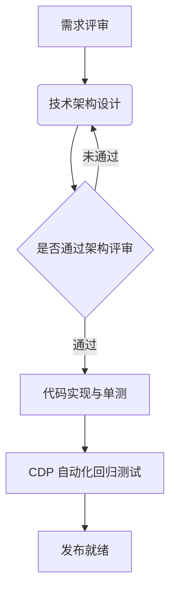

### 2. Mermaid 时序图（Sequence Diagram）
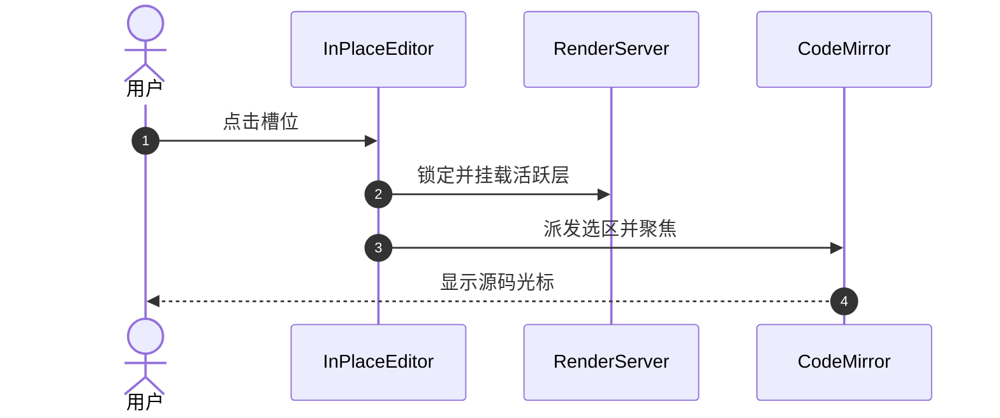

### 3. Mermaid 类图（Class Diagram）
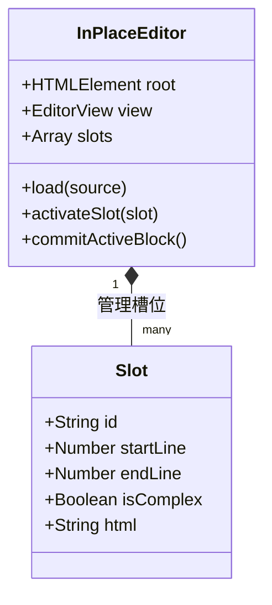

### 4. Mermaid 状态图（State Diagram）
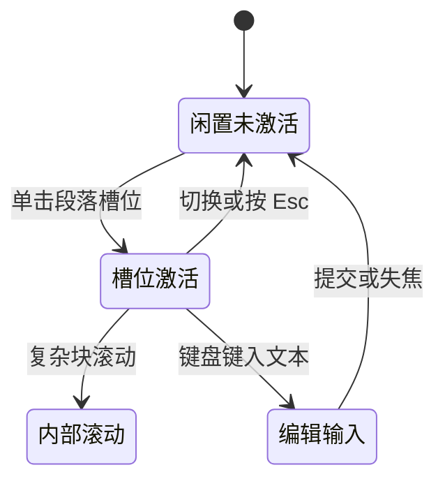

### 5. Mermaid 实体关系图（ER Diagram）
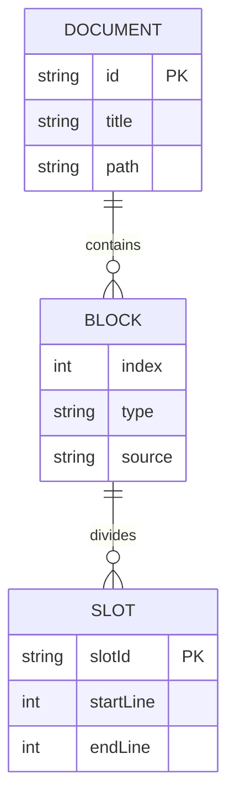

### 6. Mermaid 甘特图（Gantt Chart）
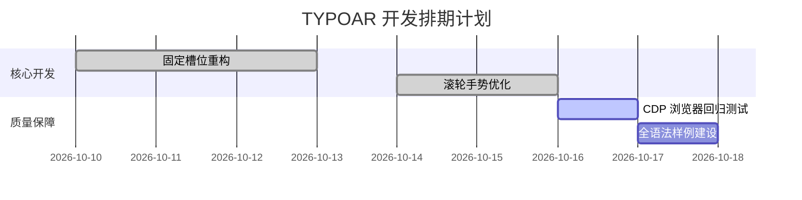

### 7. Mermaid 饼图（Pie Chart）
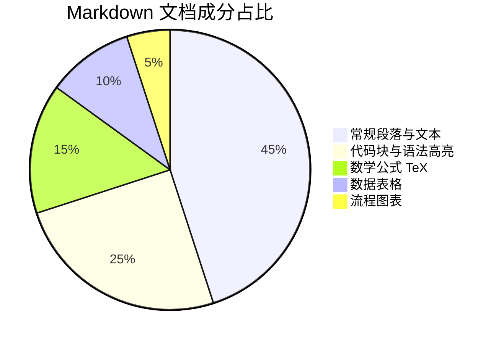

### 8. Mermaid Git 分支图（Git Graph）
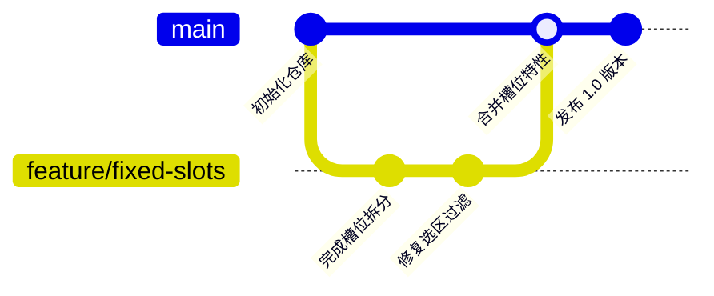

### 9. Mermaid 思维导图（Mindmap）
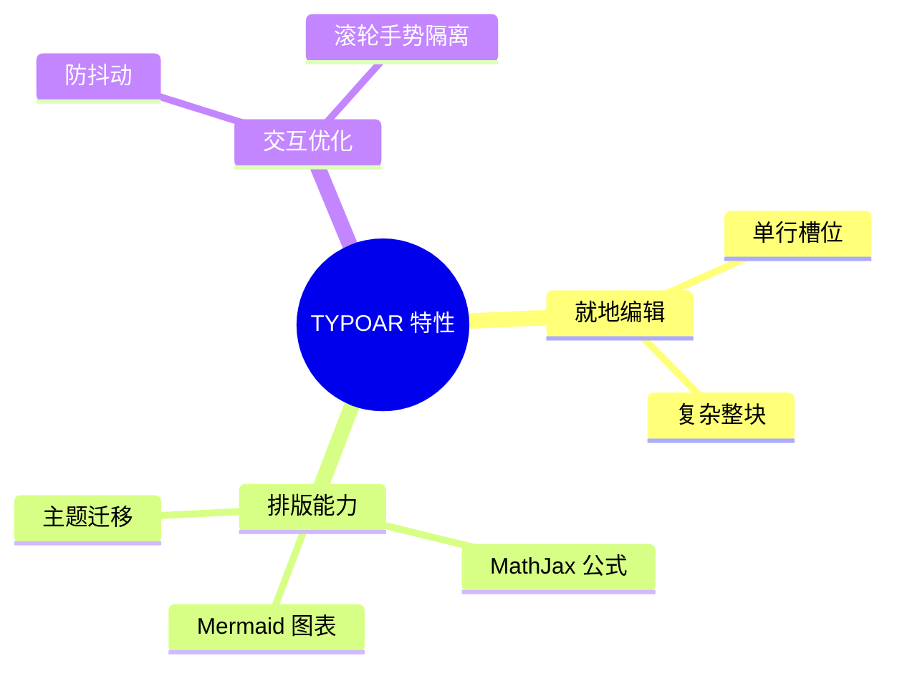

### 10. Mermaid 时间线（Timeline）
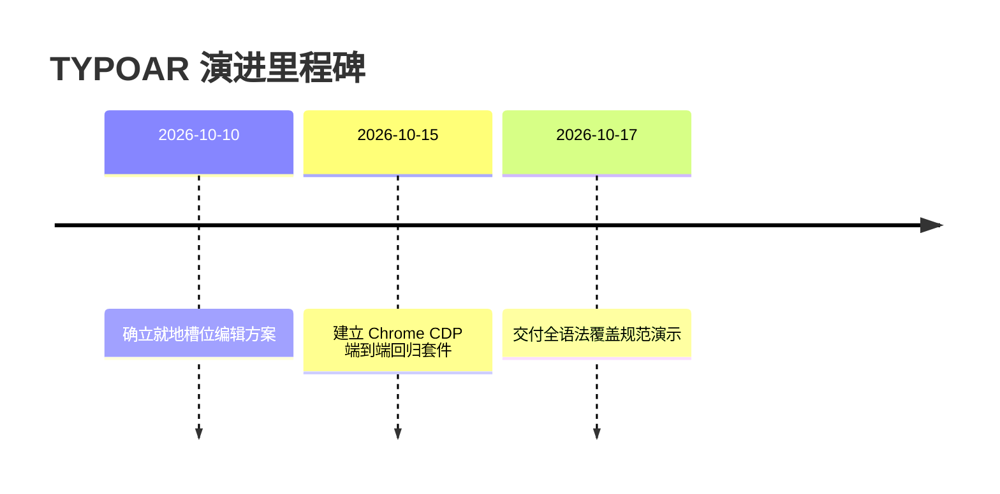

### 11. 传统引擎 Flowchart.js 示例
```flow
st=>start: 开始流程
op=>operation: 执行解析操作
cond=>condition: 是否成功?
e=>end: 流程结束

st->op->cond
cond(yes)->e
cond(no)->op
```

### 12. 传统引擎 js-sequence-diagrams 示例
```sequence
Alice->Bob: 发送同步请求
Bob-->Alice: 确认响应数据
Note over Alice,Bob: 双方数据保持一致
```

---

## 十七、HTML 原生扩展与交互组件

本节展示 HTML 原生标签（折叠面板、音视频结构、进度条、上标下标与多样式容器）。根据安全规范，不嵌入外部脚本、表单与不可控网络框架。

### 1. 详情折叠面板（Details & Summary）
<details style="margin: 1em 0; padding: 12px; background: rgba(0,0,0,0.03); border-radius: 8px;">
  <summary style="font-weight: bold; cursor: pointer;">点击展开查看高级调试参数</summary>
  <div style="margin-top: 10px;">
    <p>以下为内部参数快照：</p>
    <ul>
      <li><code>activeRange</code>: <code>{ from: 120, to: 240 }</code></li>
      <li><code>wheelOwner</code>: <code>inner</code></li>
      <li><code>overscroll-behavior</code>: <code>contain</code></li>
    </ul>
  </div>
</details>

### 2. 原生进度条（Progress）
任务执行进度展示：
<progress value="75" max="100" style="width: 100%; height: 16px;"></progress>

### 3. 多媒体占位与响应式图片标签
<picture>
  <source srcset="assets/geometry.svg" type="image/svg+xml">
  
</picture>

### 4. 样式化高源码低渲染高度块（滚轮编辑性能测试项）
<div class="compact-code-demo" style="height: 30px; overflow: hidden; background: #2d3748; color: #f7fafc; padding: 4px 10px; border-radius: 4px; font-family: monospace; font-size: 13px;">
  <div>第一行超长脚本内容声明：const config = { debug: true, port: 8080 };</div>
  <div>第二行脚本逻辑执行声明：console.log("执行初始化步骤 A");</div>
  <div>第三行脚本逻辑执行声明：console.log("执行初始化步骤 B");</div>
  <div>第四行脚本逻辑执行声明：console.log("执行初始化步骤 C");</div>
  <div>第五行脚本逻辑执行声明：console.log("执行初始化步骤 D");</div>
  <div>第六行脚本逻辑执行声明：console.log("执行初始化步骤 E");</div>
</div>

---

## 十八、外部方言兼容性围栏展示

本节列出主流专有 Markdown 方言（如 WikiLinks、Obsidian Callout、PlantUML 等）。在通用 CommonMark 环境下以语法示例围栏呈现，供兼容性核对。

### 1. 双链 WikiLinks 示例（围栏呈现）
```markdown
欢迎查阅 [[核心架构设计|架构白皮书]] 以及 [[API 接口规范]]。
嵌入引用的图片语法为：![[系统拓扑图.png]]。
```

### 2. Obsidian 扩展 Callout 示例（围栏呈现）
```markdown
> [!info]+ 可折叠信息卡片
> 这是默认展开的内容块。
> > [!bug]- 嵌套可折叠缺陷说明
> > 这是默认收起的内容块。
```

### 3. PlantUML 状态机源码示例（围栏呈现）
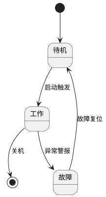

### 4. Chart.js 数据可视化配置（围栏呈现）
```chart
{
  "type": "bar",
  "data": {
    "labels": ["一月", "二月", "三月"],
    "datasets": [{
      "label": "吞吐量 (MB/s)",
      "data": [120, 190, 300]
    }]
  }
}
```

---

## 十九、长文本折行与压力边界检查

本节提供长字符串无断点文本、多语言字符交替与复杂嵌套，用于验证排版容器边界、横向溢出控制与滚动流畅性。

### 1. 超长中英混排与无空格文本自动折行
这是一段用于测试长文本自然换行的样本句子，混合了中文语句、英文术语（如 AsynchronousNonBlockingIOCommunicationProtocolSpecification）、数字与特殊符号（2026-10-17T09:30:00.000Z），并且紧接着一段长连续英文字符串abcdefghijklmnopqrstuvwxyzABCDEFGHIJKLMNOPQRSTUVWXYZ0123456789_abcdefghijklmnopqrstuvwxyzABCDEFGHIJKLMNOPQRSTUVWXYZ0123456789用于检验排版容器是否能根据word-break设置进行正确的截断换行，避免产生意外横向拉伸破坏视窗布局。

### 2. 密集 Emoji 与特殊标点交替
:fire: :rocket: :art: :bulb: :tada: :star: :zap: :white_check_mark: :checkered_flag: :mag: :wrench: :hammer: :package: :computer: :scroll: :memo: :triangular_ruler: :bar_chart: :globe_with_meridians: :shield:

### 3. 大型高复杂度数学公式排版
$$
\begin{pmatrix}
\cos\theta_1 & -\sin\theta_1 & 0 \\
\sin\theta_1 & \cos\theta_1 & 0 \\
0 & 0 & 1
\end{pmatrix}
\begin{pmatrix}
1 & 0 & 0 \\
0 & \cos\theta_2 & -\sin\theta_2 \\
0 & \sin\theta_2 & \cos\theta_2
\end{pmatrix}
\begin{pmatrix}
\cos\theta_3 & -\sin\theta_3 & 0 \\
\sin\theta_3 & \cos\theta_3 & 0 \\
0 & 0 & 1
\end{pmatrix}
=
\begin{bmatrix}
R_{11} & R_{12} & R_{13} \\
R_{21} & R_{22} & R_{23} \\
R_{31} & R_{32} & R_{33}
\end{bmatrix}
$$

---

## 二十、脚注与参考链接定义区

本节集中放置全文引用的脚注说明与参考链接定义，符合学术与工程技术写作惯例。

[^1]: 这是来自第一处引用的常规单行脚注说明。
[^2]: 这是包含多段落的复合脚注定义。  
    缩进第二段阐明补充实验数据与参考论文来源。
[^long]: 这是一个长内容脚注：在排版渲染时，脚注内容被集中渲染到文档底部的 `<section class="footnotes">` 容器中。

[markdown-ref]: https://daringfireball.net/projects/markdown/
[ref-logo-img]: assets/typo-ar.png
